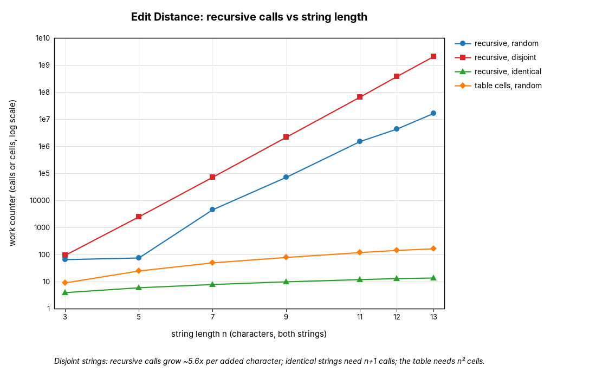
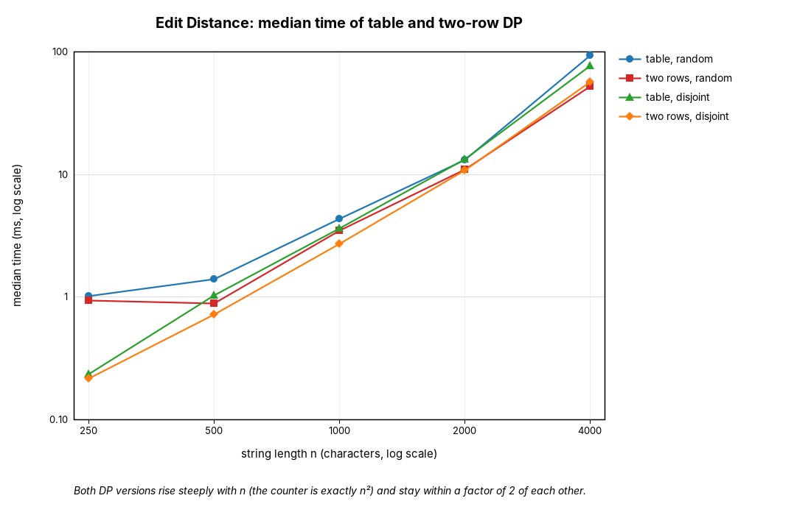
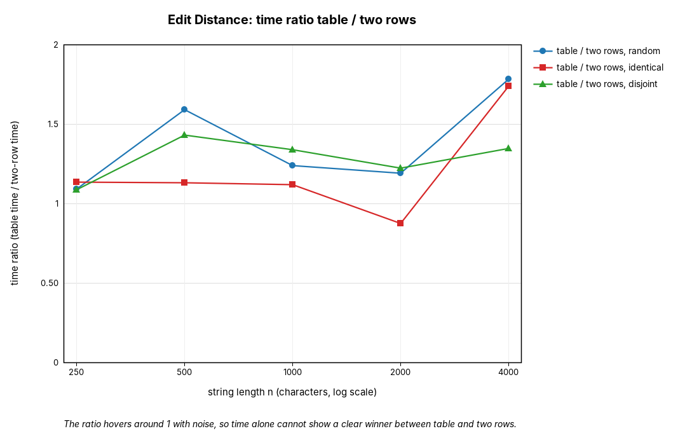
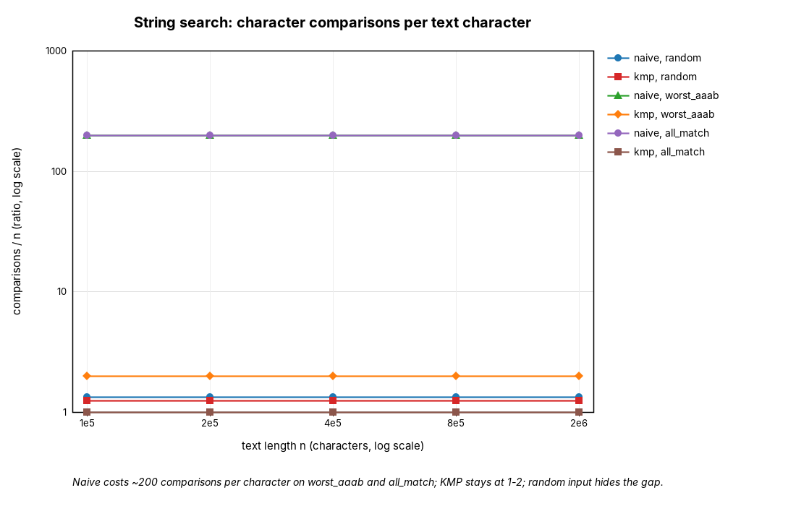
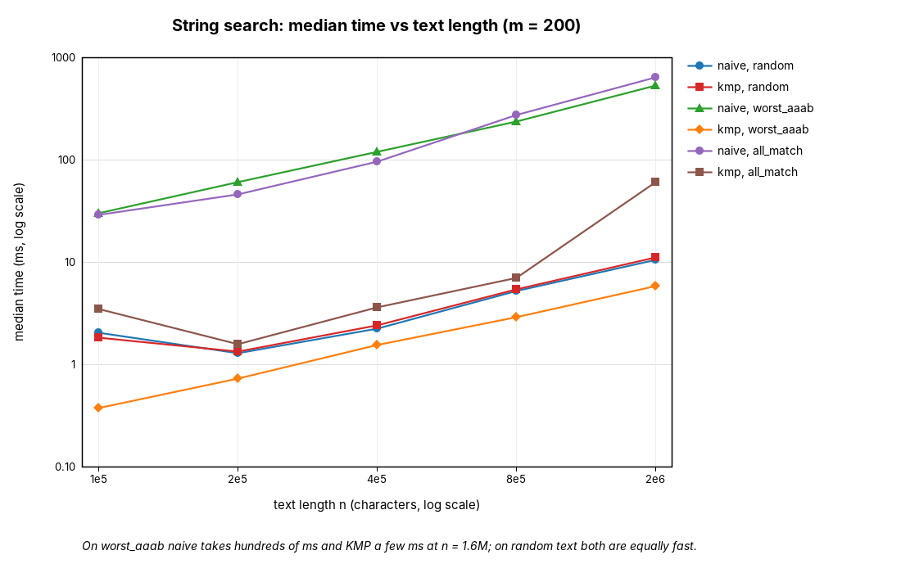

# Assignment 4 Report: Dynamic Programming and String Algorithms

## 1. Experiment Design Card

| Field | Content |
|---|---|
| **Question (Edit Distance)** | Does the recursive version really blow up exponentially while the table and two-row versions grow like n·m? Does the input change the cost of each version? Do two rows buy speed or only memory? |
| **Question (String search)** | Does naive search reach n·m on a bad input while KMP stays linear? Does random text hide this? |
| **Sizes (Edit Distance)** | Recursive (and for comparison also table and two rows): n = 3, 5, 7, 9, 11, 12, 13. The recursive version needs ~2·10⁹ calls at n = 13 on the worst input (about 5 s), so n = 13 is the largest size I can run without waiting minutes. Table and two rows: n = 250, 500, 1000, 2000, 4000 (largest = 16x smallest, 16 million cells at the top, well under a second). |
| **Sizes (Search)** | Text length n = 100 000, 200 000, 400 000, 800 000, 1 600 000 (16x range), pattern length m = 200. Smaller texts finish in under a millisecond, which would be too noisy. The worst case for naive is 320 million comparisons at the top, well under a second. |
| **Inputs (Edit Distance)** | `random`: two independent random strings over {A,C,G,T}, the typical case. `identical`: the same string twice, the best case for the recursion (it only moves diagonally). `disjoint`: "AAAA…" versus "BBBB…", no character ever matches, so the recursion takes all three branches at every call: the worst case. |
| **Inputs (Search)** | `random`: random DNA text and pattern, the average case. `worst_aaab`: text "AAAA…A", pattern "AA…AB" (199 A's and a B), naive compares almost the whole pattern at every start and then fails: its worst case. `all_match`: text "AAAA…A", pattern "AA…A", every position matches (all overlapping matches), a heavy output for both algorithms. |
| **Metrics** | Edit Distance: `ops` = number of recursive calls (recursive) or cells computed (table, two rows), counted inside the code. This is the unit of work that the theory counts. Search: `ops` = number of character comparisons `text[i] == pattern[j]`, counted inside the loops; for KMP this includes the comparisons used to build the LPS array. Time: median of 5 runs (3 runs for the recursive version) after one warm-up run, in ms. |
| **Prediction (written from the theory)** | Recursive: calls grow by a constant factor per extra character (between 3 and 5.8x); roughly a straight line on a log axis; `disjoint` is the worst and `identical` needs only n+1 calls. Table and two rows: exactly n·m cells, independent of the input, time about 4x longer when n doubles; two rows is about as fast as the table, maybe slightly faster because of the cache. Naive: ~1.3 comparisons per character on random text, about m = 200 per character on `worst_aaab` and `all_match`. KMP: between 1 and 2 comparisons per character on every input; time linear in n. On random text I expect both search algorithms to look the same. |
| **Plots** | 1: recursive calls vs n, log axis: how fast does the recursion explode, and which input hurts it? 2: DP time vs n, log-log: do table and two rows follow n²? 3: time ratio table / two rows: does the saved memory cost or gain time? 4: comparisons per text character (a ratio), log axis: naive vs KMP on each input. 5: search time vs n, log-log: does the counter match the clock? |

Changes after the first runs: the recursive sizes were first 3 to 12, and I moved to 3 to 13 so that the exponential growth is visible over more points. The captions of plots 3 and 5 were reworded after the time measurements turned out to be noisy.

## 2. DP design (state, transition, base case)

The Java source has no comments, so the DP design required in the source comments is given here.

**A. Recursive.** State: `solve(i, j)` = edit distance between the first i characters of a and the first j characters of b. Transition: if `a[i-1] == b[j-1]` then `solve(i-1, j-1)`, otherwise `1 + min(solve(i, j-1), solve(i-1, j), solve(i-1, j-1))` (insert, delete, replace). Base case: `solve(0, j) = j` and `solve(i, 0) = i`. Nothing is stored, so the same state is solved again many times.

**B. Table.** State: `d[i][j]` as above, stored in an (n+1) x (m+1) table. Transition: the same as A, filled row by row. Base case: `d[i][0] = i`, `d[0][j] = j`. Time O(n·m), memory O(n·m).

**C. Two rows.** State: `prev[j]` = `d[i-1][j]` and `curr[j]` = `d[i][j]`. Transition: the same as B, reading only `prev[j-1]`, `prev[j]`, `curr[j-1]`, then swapping the rows. Base case: `prev[j] = j` at the start and `curr[0] = i` for each row. Time O(n·m), memory O(m).

## 3. Plots and results

All numbers come from `results/results.csv` (123 rows, seed 42).

*Takeaway: on disjoint strings the recursive calls grow about 5.6x per added character (2.1·10⁹ calls at n = 13); identical strings need only n+1 calls, and the table needs n² cells.*

*Takeaway: both DP versions rise steeply with n (the counter is exactly n² cells) and stay within a factor of 2 of each other.*

*Takeaway: the time ratio hovers around 1, up to about 1.9 at n = 4000, and is noisy, so time alone cannot show a clear winner between table and two rows.*

*Takeaway: naive costs about 200 comparisons per character on `worst_aaab` and `all_match`; KMP stays between 1 and 2 on every input; random input hides the gap.*

*Takeaway: at n = 1.6 million on `worst_aaab`, naive takes hundreds of ms and KMP a few ms; on random text both are equally fast.*

## 4. Prediction vs result

**Edit Distance.** Predicted: exponential growth for the recursion, worst on `disjoint`; exactly n·m cells for B and C. Seen: recursive calls on `disjoint` are 2 193 844 at n = 9, 377 393 953 at n = 12 and 2 114 900 428 at n = 13, a factor of 5.6 per character, which fits the theoretical limit of 3 + 2√2 ≈ 5.83. On `random` the growth is slower (16.7 million calls at n = 13), because random strings share characters and the recursion often takes the cheap diagonal step. On `identical` the recursion needs n + 1 calls. Table and two rows computed exactly n² cells on all three inputs, so the counter does not depend on the input. One surprise: I expected two rows to be a bit faster because of the cache; at n = 4000 it was about 1.5 to 1.9x faster in some runs, but at other sizes it was equal and in one `identical` run it was slower. The time measurements are too noisy for a clear claim (JIT warm-up, garbage collection of the big table), so I rely on the counter.

**String search.** Predicted: naive about m per character on bad input, KMP between 1 and 2, equal on random text. Seen: on `worst_aaab` naive made 319 960 200 comparisons at n = 1.6 million (199.97 per character) and KMP 3 200 198 (2.0 per character); on `all_match` it was 319 960 200 versus 1 600 199 (1.0 per character). On random text naive needed 1.33 and KMP 1.25 comparisons per character, so the two were equal in time (about 10 ms at n = 1.6 million, with differences of a few ms that are within noise). The counters matched the prediction closely. The one small difference: the KMP time on `all_match` was 10x higher than on `worst_aaab` although its counter is lower. The reason is the output: 1.6 million matches are stored in a list of boxed Integers, which costs memory and garbage collection and is not counted by the comparison counter.

## 5. Short answers

**Which input made your string search slowest, and why?** `worst_aaab` and `all_match` were slowest for naive search: both made 320 million comparisons at n = 1.6 million (200 per character), and took between 0.4 and 0.7 s on my machine. For every start position the naive search compares nearly all m = 200 characters of the pattern, and then it throws that information away when it moves one position forward, so the cost is n·m. `all_match` was also the slowest input for KMP (about 60 ms), but only because of the 1.6 million stored matches; its comparison count was just 1.0 per character.

**How large an n could the recursive Edit Distance handle, and what stopped it?** On the worst input (`disjoint`) it handled n = 13 in about 5 s (2.1·10⁹ calls). The calls grow by a factor of about 5.6 per character, so n = 14 would take about 30 s, n = 16 several minutes and n = 20 hours (extrapolation from the measured factor, not measured). What stops it is time, not memory: the recursion depth is only 2n, but the same states are solved again and again (there are only (n+1)² different states, and the recursion makes billions of calls for them). On random strings the limit is higher, because n = 13 needed only 34 ms.

**What do you gain and what do you lose with two rows instead of the full table?** You gain memory: 2·(m+1) integers instead of (n+1)·(m+1); at n = m = 4000 that is about 8 000 versus 16 million integers (64 MB), and the table version needs more garbage collection and cache traffic. In my runs two rows was about as fast or a bit faster, but the noise is too large to claim more. You lose the table itself: with only two rows you cannot walk back to recover which insertions, deletions and replacements were used, so you only get the number. If the platform wants to show the user "what to fix" (for example the corrected street name), the full table (or a smarter method such as Hirschberg's) is needed.

**Which string search for the city platform, and why?** KMP. On random text it was as fast as naive search, so it costs nothing on typical queries, and on repetitive log lines (like `worst_aaab`) it was about 50 to 130x faster in my runs, with a guaranteed bound of at most about 2n comparisons. Log files are the place where the platform meets repetitive data, and a guarantee is worth more than a small average gain. The price is the LPS array of size m and slightly more code. For the short street-name search box, where the text is tiny, either method is fine.

## 6. A paragraph on time

The measured times are medians of 5 runs (3 for the recursive version) after one warm-up run, on one laptop-class machine with the JVM default settings. They show the big effects clearly: the recursion at 4.8 s for n = 13, and naive search at hundreds of ms against a few ms for KMP on the bad input. They do not show small effects reliably: in repeated runs the table-to-two-rows ratio moved between 0.9 and 1.9, and the naive time on `worst_aaab` at n = 1.6 million varied between 0.38 and 0.63 s in my runs, although its counter was always exactly 319 960 200. The reasons are JIT compilation, garbage collection, memory caches and other processes on the machine. This is why the counters (calls, cells, comparisons) are my main evidence: they are exact, reproducible with the fixed seed, and they measure the cost that the theory talks about.
